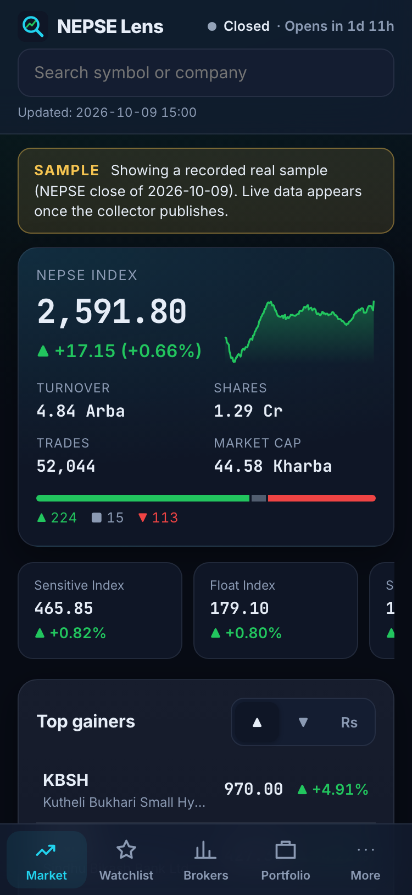
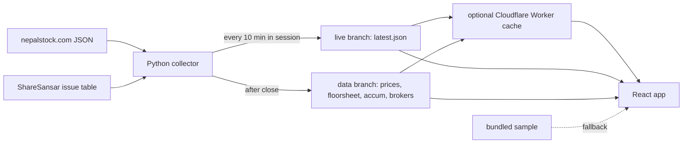

# NEPSE Lens

The Nepal Stock Exchange has no official public API, and broker-level flows are only visible one day at a time.
NEPSE Lens is a scheduled Python collector plus a mobile-first web and Android app. The collector snapshots the
market every 10 minutes during trading hours and, after each close, aggregates the full floorsheet by buyer and
seller broker into an append-only history on a git branch. From that history it derives **broker accumulation**
(cumulative net shares per broker per stock) that NEPSE itself does not publish. English and नेपाली UI.

[](https://github.com/Sabin78910/nepse-lens/actions/workflows/ci.yml)
[](LICENSE)

**Live:** https://sabin78910.github.io/nepse-lens/ · Data is **delayed and unofficial, not investment advice.**



## Features

- **Floorsheet aggregation.** Every trade is summed into the buyer's buy side and the seller's sell side per
  (symbol, broker), de-duplicated by contract id because pages can shift while they are fetched. A day is saved
  only when every row carries the target business date, so a partial floorsheet is never stored.
- **Broker accumulation and flow summaries.** Per-stock accumulation is rebuilt from the full daily history, so
  re-running a day can never double count. Broker summaries give top net buys and sells over 1D, 1W, 1M, 3M
  (5, 22 and 66 trading days) and All, plus a concentration signal: the share of bought volume held as net buys by
  the top 5 accumulators.
- **Market-calendar aware scheduling.** Pure functions handle Nepal time (UTC+5:45), the 11:00 to 15:00 session,
  public holidays and the April 2026 switch of the trading week from Sunday to Thursday to Monday to Friday. Missing
  price days are detected and filled oldest first.
- **Technical indicators** in `src/lib/indicators.ts`: SMA, EMA, Wilder's RSI, MACD, Bollinger bands, period returns
  and high/low. The stock page shows the SMA overlay, RSI, returns and range on SVG charts drawn without a chart library.
- **Portfolio maths with Nepal fees.** Weighted average cost including buy fees, bonus shares at zero cost, broker
  commission slabs from the SEBON schedule, SEBON fee, DP charge, capital gains tax by holding period, and break-even sell price.
- **Watchlist and price alerts** (above, below, % up, % down); fired alerts disarm, and Android shows local notifications.
  IPO, FPO and right-share calendar.

## How it works



1. **Live** (`collect-live.yml`): every 10 minutes around the session on weekdays; the collector itself only runs from 10:55 to 15:10
   Nepal time on trading days. The snapshot is force-pushed as the single commit on the `live` branch.
2. **End of day** (`collect-eod.yml`): at 15:30, 17:15 and 21:00 Nepal time, and 08:15 the next morning before the
   floorsheet resets. It stores the day's floorsheet aggregate as gzipped CSV, upserts daily prices, merges index
   history, rebuilds accumulation and broker summaries, and refreshes the IPO calendar on the `data` branch.
3. **Requests** go one at a time with a 1.2 second pause and up to 3 attempts with backoff. Every command is
   idempotent: re-running a day rewrites byte-identical files.
4. **The app** reads, in order: `VITE_API_URL` (optional Worker edge cache), the static JSON on the `live` and
   `data` branches, then a recorded real sample (NEPSE close of 2026-10-09) with a visible SAMPLE banner.

Data layout on the `data` branch: `prices/SYMBOL.json` (`[date, open, high, low, close, volume, turnover]`),
`floorsheet/YYYY/YYYY-MM-DD.csv.gz` (`symbol,broker,buy_qty,sell_qty,buy_amt,sell_amt`), `accum/SYMBOL.json`,
`brokers/summary.json`, `index/nepse.json`, `meta/*.json`, `issues.json`, `manifest.json`.

## Tech stack

Python 3.12 (httpx, NepseUnofficialApi, pytest) · TypeScript · React 19 · Vite · Capacitor 8 (Android, local
notifications) · Cloudflare Workers (optional) · GitHub Actions and Pages · Vitest + Testing Library · ESLint · CodeQL

## Getting started

Prerequisites: Node.js 22 and Python 3.12 (the versions CI uses).

```bash
npm ci
npm run dev         # app (falls back to the bundled sample when live data is unreachable)
npm test            # Vitest
npm run lint        # ESLint
npm run typecheck   # tsc --noEmit
npm run build       # typecheck + production build
npm run cap:sync    # build and sync into the Android project
```

Collector:

```bash
cd collector
pip install -r requirements.txt -r requirements-dev.txt
python -m pytest -q
python -m nepse_lens live --out /tmp/live --force          # one market snapshot
python -m nepse_lens eod --data /tmp/data --meta           # end of day, with the securities list
python -m nepse_lens backfill-prices --data /tmp/data --days 250
```

## Project structure

```
collector/   Python collector: fetch (rate-limited client), aggregate (pure data shaping), market calendar, store, CLI
src/lib/     app logic: data sources, accumulation, indicators, fees, portfolio, alerts, formatting, i18n
src/pages/   Market, Stock, Brokers, Watchlist, Portfolio and More screens
src/components/  SVG charts and shared UI
public/sample/   recorded real market data used as the offline fallback
worker/      optional Cloudflare Worker that caches the branch JSON at the edge
android/     Capacitor Android project
store/       Play listing text
docs/        screenshots and interaction notes
```

## Testing and CI

- **Collector tests** (`collector/tests/test_collector.py`, pytest): trading week before and after April 2026,
  holidays, Nepal-time phases, live-window margins, gap detection, buy/sell aggregation and contract-id dedupe,
  total buys equal total sells, CSV round trip, accumulation indexing, broker summary windows, idempotent price
  upserts, index history merge, contact details dropped from securities, and byte-stable floorsheet storage.
- **App tests** (Vitest): fees, indicators, accumulation, market clock, market data, alerts, portfolio, the data
  source fallback, storage, i18n and Worker routing.
- **Workflows:** `ci.yml` (lint, typecheck, Vitest, build, `npm audit` for high-severity issues, then pytest on
  Python 3.12), `codeql.yml`, `collect-live.yml`, `collect-eod.yml`, `deploy.yml` (Pages), `android.yml` (release App
  Bundle, signed when the keystore secrets exist) and `worker.yml` (optional).

## Design decisions and limitations

- **Delayed, unofficial data, not investment advice.** The collector reads the JSON nepalstock.com serves to its own
  website through the open-source [NepseUnofficialApi](https://github.com/basic-bgnr/NepseUnofficialApi) wrapper,
  pinned to a reviewed commit and installed at run time, not vendored. That site serves an incomplete TLS chain, so
  certificate verification is switched off for it, as the wrapper documents.
- **Accumulation is not holdings.** NEPSE (and ShareSansar) serve only the latest business day's floorsheet, so
  accumulation starts on the first collected day and grows daily. Prices and the index are backfilled 250 days by default.
- **Git branches as the database.** Free, versioned and served as static files, which suits a small daily dataset;
  the trade-off is minutes of latency and no query layer, so derived views are either precomputed by the collector or computed in
  the app from compact per-symbol files.
- **Polite collection.** One request at a time with pauses; IPO, FPO and right-share data comes from ShareSansar's
  public table, which its robots.txt allows. Company e-mails and websites are deliberately not stored.

## License

MIT, see [LICENSE](LICENSE). Privacy policy: https://sabin78910.github.io/privacy-policy/

## Author

Sabin Khanal · [Portfolio](https://sabinkhanal13.com.np) · [LinkedIn](https://www.linkedin.com/in/sabin-khanal-950163326) · [GitHub](https://github.com/Sabin78910)
