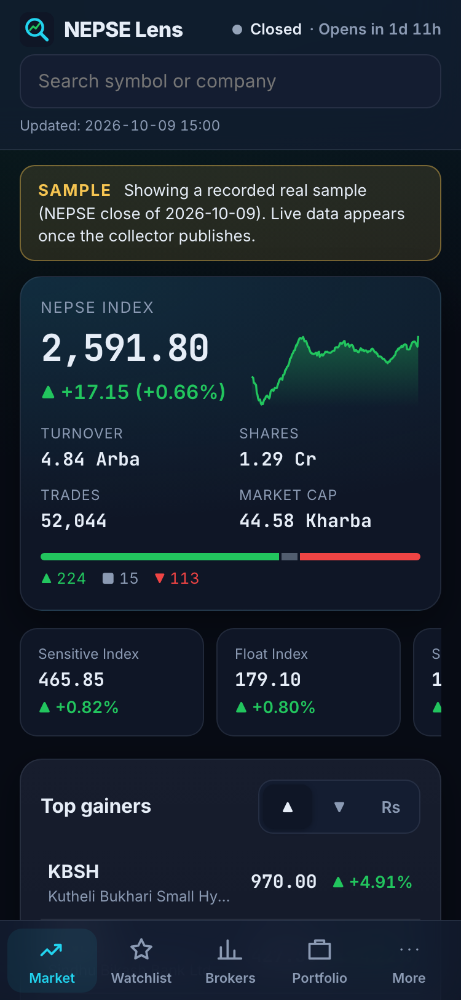

# NEPSE Lens

A fast, mobile-first Nepal Stock Exchange app: live market board, stock charts, **broker accumulation** tracker,
watchlist with price alerts, portfolio P/L with Nepal fees, IPO/FPO/right-share calendar. English + नेपाली.

**Live:** https://sabin78910.github.io/nepse-lens/ · Data is **delayed and unofficial — not investment advice.**



## Data (honest notes)
- NEPSE has no official public API. The collector reads the JSON that nepalstock.com serves to its own website,
  using the open-source [NepseUnofficialApi](https://github.com/basic-bgnr/NepseUnofficialApi) wrapper for the token handshake
  (pinned to a reviewed commit, installed at run time, not vendored).
- Works: market status, summary, indices and sub-indices, live market, today's prices, company list, holidays,
  index history (about 1 year), daily prices by date (about 1 year back), and the **full floorsheet with buyer/seller broker numbers**.
- Does not work: floorsheets for past days. NEPSE (and ShareSansar) only serve the latest business day's floorsheet,
  so broker accumulation starts on the first collected day and grows daily. Prices and the index are backfilled ~1 year.
- **Broker accumulation** = cumulative net (bought − sold) shares per broker per stock since collection began.
  NEPSE does not publish broker holdings; this is not holdings.
- IPO/FPO/right shares come from ShareSansar's public table (robots.txt allows it).
- Politeness: one request at a time with pauses; a live snapshot about every 10 minutes during market hours; end-of-day jobs a few times a day.
- The app ships a **recorded real sample** (NEPSE close of 2026-10-09) and shows a SAMPLE banner whenever it falls back to it.

## How it runs
| Workflow | When | Output |
|---|---|---|
| `collect-live.yml` | every 10 min, Mon–Fri 11:00–15:00 NPT | `live` branch `latest.json` (single commit, force-pushed) |
| `collect-eod.yml` | 15:30, 17:15, 21:00 NPT and 08:15 next morning; or manual with `date` / `backfill_days` | `data` branch history |
| `deploy.yml` | push to main | GitHub Pages PWA |
| `android.yml` | push to main | release AAB artifact (signed when `KEYSTORE_*` secrets exist) |
| `worker.yml` | optional | Cloudflare Worker cache (needs `CLOUDFLARE_API_TOKEN`, `CLOUDFLARE_ACCOUNT_ID`) |

Every collector run is idempotent: re-running a day rewrites identical files, and missing price days are filled on the next run.

### Data layout (`data` branch)
`manifest.json`, `meta/securities.json`, `meta/brokers.json`, `meta/holidays.json`, `index/nepse.json`,
`prices/SYMBOL.json` (`[date, open, high, low, close, volume, turnover]`),
`floorsheet/YYYY/YYYY-MM-DD.csv.gz` (`symbol,broker,buy_qty,sell_qty,buy_amt,sell_amt`),
`accum/SYMBOL.json`, `brokers/summary.json` (1D/1W/1M/3M/All top net buys and sells), `issues.json`.

The app reads `VITE_API_URL` (Worker) if set at build time, otherwise the static JSON on GitHub, otherwise the bundled sample.

## Develop
```bash
npm ci && npm run dev          # app
npm test && npm run lint       # checks
cd collector && pip install -r requirements.txt -r requirements-dev.txt && python -m pytest -q
python -m nepse_lens live --out /tmp/live --force       # one snapshot
python -m nepse_lens eod --data /tmp/data --meta         # end of day
```

Sync: optional "Sync across devices" (More tab) shares your watchlist, alerts and portfolio lots between devices. Data is end-to-end encrypted on your device before upload (AES-GCM); the server stores only ciphertext. The sync code (kept in localStorage under `sabin-labs-sync-code`, shared with other Sabin Labs apps) is the only key: keep it private, it cannot be recovered.

Privacy: https://sabin78910.github.io/privacy-policy/ · License: MIT
